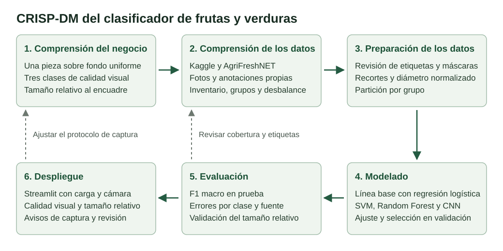

# Metodología CRISP-DM

Este índice organiza la metodología del clasificador en seis documentos, uno por fase.

La adaptación sigue la guía IBM SPSS Modeler CRISP-DM Guide, versión 18.3, y la consigna de Algoritmos y Programación III. CRISP-DM se aplica como ciclo iterativo: errores y hallazgos pueden llevar a revisar datos, etiquetas, preparación o modelos.

## Fases

1. [Comprensión del negocio](01_business_understanding.md)
2. [Comprensión de los datos](02_data_understanding.md)
3. [Preparación de los datos](03_data_preparation.md)
4. [Modelado](04_modeling.md)
5. [Evaluación](05_evaluation.md)
6. [Despliegue](06_deployment.md)

## Documentos de apoyo

- [Ética e impactos](supporting_docs/ethics_considerations.md)
- [Fundamentos matemáticos y teóricos](supporting_docs/mathematical_and_theoretical_foundations.md)
- [Criterios de calidad visual](criterios-calidad.md)
- [Plan simple: pasos para reproducir](plan_simple.md)

## Diagrama

## Alcance y estado del proyecto

Con una foto de una fruta o verdura individual sobre un fondo sencillo, el prototipo identifica qué producto es (entre 12) y clasifica su apariencia externa como good, regular o bad. También calcula un diámetro normalizado que expresa la ocupación de la foto, no centímetros. Apoya la inspección humana; no determina inocuidad, estado interno ni precio.

Se combinan Fruit Quality Classification de Kaggle, AgriFreshNET y fotos propias. Los modelos son regresión logística, SVM lineal y Random Forest sobre atributos de color, textura y forma, y una CNN de 4 bloques; el estado final es el promedio de Random Forest y CNN. La interfaz es Streamlit.

| Fase | Estado |
| --- | --- |
| Comprensión del negocio | Alcance, criterios, riesgos, ética e impactos definidos. |
| Comprensión de los datos | Inventario y EDA disponibles; la clase regular viene casi toda de AgriFreshNET. |
| Preparación | Segmentación y reparto final sin fotos gemelas entre particiones. |
| Modelado | Hiperparámetros con `GridSearchCV` por grupos; CNN con parada temprana dentro de train. Falta reentrenar con el reparto final. |
| Evaluación | Validación, fotos de celular y prueba, una vez cada una. Pendiente. |
| Despliegue | App Streamlit que muestra fruta, estado y tamaño relativo, y rechaza fotos que no puede leer. |
