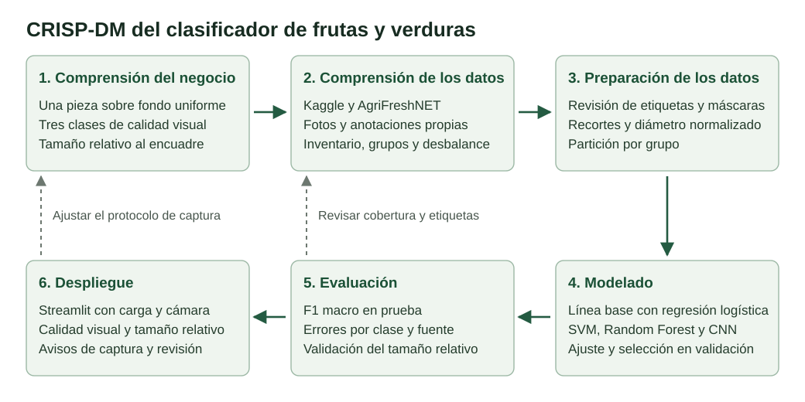

# Workflow CRISP-DM personalizado

El diagrama resume el flujo específico del clasificador: define el problema y las clases, explora las tres fuentes, revisa y prepara las imágenes, compara modelos, evalúa sus errores y planea su uso en Streamlit. Las flechas punteadas muestran retornos desde errores o dificultades de captura hacia las fases que pueden corregirlos.

El workflow se basa en la guía de proceso CRISP-DM de IBM y en la consigna del curso. No es lineal: un problema de máscara puede devolver el trabajo a preparación; una diferencia por fuente, a comprensión de datos; un resultado insuficiente, a modelado; y una dificultad en cámara puede llevar a revisar el protocolo de uso.

| Fase | Pregunta | Punto de salida |
| --- | --- | --- |
| 1. Comprensión del negocio | ¿Qué problema visual se busca apoyar y qué límites tiene la solución? | Alcance y criterios acordados. |
| 2. Comprensión de los datos | ¿Qué contienen las fuentes y dónde hay sesgos o defectos? | EDA y reporte de calidad. |
| 3. Preparación | ¿Qué ejemplos se incluyen, cómo se segmentan y cómo se evitan fugas? | Datos revisados y particiones por grupo. |
| 4. Modelado | ¿Qué modelos cumplen la tarea bajo el diseño experimental? | Modelos y ajustes registrados. |
| 5. Evaluación | ¿Qué modelo responde mejor al objetivo y dónde falla? | Métricas finales, errores y decisión. |
| 6. Despliegue | ¿Cómo se prueba el modelo y se comunican sus límites? | Interfaz demostrable y plan de seguimiento. |

El estado y la evidencia de cada fase se detallan en el [índice CRISP-DM](../crisp-dm.md) y los seis documentos numerados.
